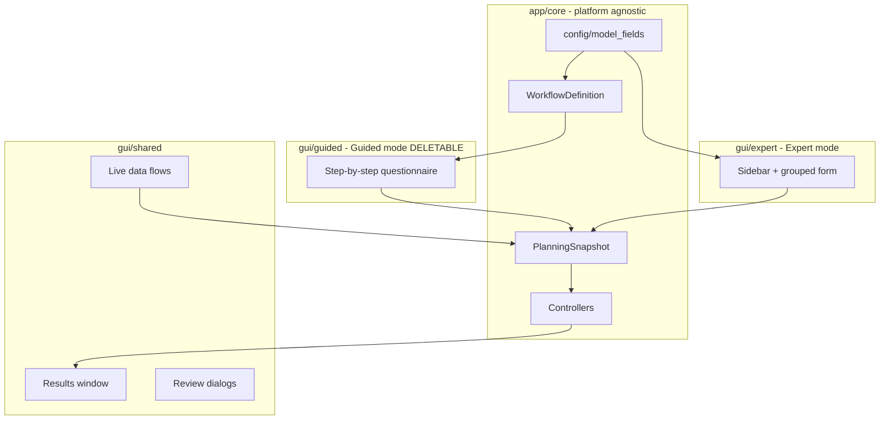

# GUI Redesign Plan

**Status:** Phases A–G complete; UX-1–UX-7 complete on web shell (2026-06-26)  
**Date:** 2026-06-21 (updated 2026-06-26)  
**Scope:** Layout and workflow redesign. Model, tax engine, simulation, and `DataService` stay unchanged. Primary UI is the **Liquid Glass web shell** (`python main.py --web` or double-click `.app`). Tkinter build remains **beta** fallback.

### UX phase completion (web)

| Phase | Deliverable | Status |
|-------|-------------|--------|
| UX-1 | Design system + app chrome | Done (`design/mockups/`, `gui/design_system/`) |
| UX-2 | Journey rail, micro-screens, completeness ring | Done |
| UX-3 | Expert search, collapsible groups, jump to guided | Done |
| UX-4 | Results overlay, tab labels, data sources | Done |
| UX-5 | Document import (tax return JSON) | Done |
| UX-6 | Self-contained macOS `.app` (py2app) | Done |
| UX-7 | Copy, spacing, journey labels, completeness weights | Done |

---

## 1. Goals

| Goal | What it means |
|------|----------------|
| **TurboTax-style guided flow** | Questionnaire pages per topic; user answers one section at a time, then runs the model |
| **Expert mode** | Direct entry of all fields (today's power-user layout), always available |
| **Forkable guided path** | Guided UI lives in an isolated package — removable without touching expert mode or core logic |
| **Well-organized fields** | Catalog-driven groups; same grouping powers guided pages and expert collapsible sections |
| **Native-app ready** | Platform-agnostic core (state, workflow, controllers) with thin Tkinter adapters; SwiftUI reimplements adapters later |
| **Expandable** | New fields flow from `config/model_fields.py` into both modes automatically |
| **Performance-aware** | Slow work shows progress; optimization pass is last |

---

## 2. Dual presentation modes

Two **presentation forks** share one **planning core**. Default on launch: **Guided**.



| Mode | Audience | UX | Package |
|------|----------|-----|---------|
| **Guided** (default) | First-time / casual planners | Linear wizard: one topic per page, Back/Continue, progress bar | `gui/guided/` only |
| **Expert** | Power users / you | Sidebar sections, all fields visible by group, direct edit | `gui/expert/` only |

**Mode switch:** Header toggle `Guided | Expert`. Preference saved in app data (`guided` default). Switching modes never discards data — both read/write the same `PlanningSnapshot`.

**Deleting guided mode later:** Remove `gui/guided/`, drop the mode toggle, point `main.py` at `gui/expert/app.py`. Core, expert, shared, and engine unchanged.

---

## 3. Layer architecture (native port hooks)

### 3.1 `app/core/` — ships to native apps

No Tkinter, no Swift. This is the contract the macOS / iOS / iPad apps reimplement against.

| Module | Responsibility |
|--------|----------------|
| `planning_snapshot.py` | Single dataclass + JSON schema for all field values, sources, mode, simulation options |
| `workflow_definition.py` | Ordered list of wizard steps derived from catalog (`ui_group`, `guided_question`) |
| `controllers/simulation.py` | `build_params(snapshot)` → `run_simulation()` |
| `controllers/live_data.py` | Plaid/market/expense orchestration; returns DTOs not dialogs |
| `controllers/llm_research.py` | Batch research; returns suggestion list |
| `controllers/adviser.py` | Holdings + what-if |
| `action_result.py` | `{ ok, title, message, level, payload }` — views decide how to display |

### 3.2 `gui/shared/` — reused by both modes (beta Tkinter)

- Review dialogs (live data, expenses, contributions, CSV)
- Results window + charts
- Formatting helpers
- Live-data action handlers that call `app/core` controllers

### 3.3 `gui/expert/` — Expert mode only

- Sidebar shell, grouped assumption form, LLM section, simulate panel
- Binds Tk widgets ↔ `PlanningSnapshot`

### 3.4 `gui/guided/` — Guided mode only (**isolated fork**)

- Wizard shell: progress, Back/Continue/Skip, step renderer
- One page per workflow step
- Optional "Import from Plaid" shortcuts on relevant steps
- **Must not import** from `gui/expert/`
- Both `guided` and `expert` import only `app/core` + `gui/shared`

### 3.5 Native transition (Phase 6+)

| Python beta | Native app |
|-------------|------------|
| `PlanningSnapshot.to_json()` | Same JSON file / iCloud document |
| `WorkflowDefinition.steps` | SwiftUI `NavigationStack` + same step IDs |
| `ModelField` metadata | Generated Swift structs or shared JSON catalog |
| `controllers/*` | Port logic to Swift **or** embed PythonKit for beta (macOS only) |
| Tkinter views | SwiftUI views per mode |

**Hook to add now:** `PlanningSnapshot` version field + export/import CLI so native app can open beta saves.

```json
{
  "snapshot_version": 1,
  "presentation_mode": "guided",
  "household_mode": "joint",
  "shared": { "inflation_rate": "3.0", ... },
  "persons": { "self": { ... }, "wife": { ... } },
  "field_sources": { "self:base_expenses": "Plaid (2026-06-21)" },
  "simulation_options": { "mode": "both", "paths": 1000, ... },
  "wizard_progress": { "last_step_id": "healthcare_self", "completed_steps": ["setup", "income_self"] }
}
```

---

## 4. Field organization (both modes)

Fields are grouped by **planning topic**, not by code layout. Groups drive expert collapsible sections **and** guided wizard pages.

### 4.1 Catalog extensions

```python
@dataclass(frozen=True)
class ModelField:
    ...
    ui_group: str | None = None          # e.g. "income_savings"
    ui_group_label: str | None = None    # e.g. "Income & Savings"
    guided_question: str | None = None   # TurboTax-style prompt; defaults to label
    guided_help: str | None = None       # Short tooltip / "Why we ask"
    guided_order: int = 0                # Sort within group
    guided_skip_if: str | None = None    # Future: conditional visibility rule
    expert_only: bool = False            # Hidden from guided wizard (advanced)
    research_group: str | None = None
    research_priority: int = 0
```

### 4.2 Standard UI groups (wizard steps)

| Step ID | Label | Scope | Example fields |
|---------|-------|-------|----------------|
| `setup` | Household setup | — | joint/separate, state, filing context |
| `timeline` | Timeline & longevity | shared | life expectancy, marriage year |
| `income_self` | Your income & savings | self | salary, contributions, retirement age |
| `income_wife` | Spouse income & savings | wife | (skipped if not modeling spouse) |
| `assets_self` | Your assets | self | initial assets, account types |
| `assets_wife` | Spouse assets | wife | |
| `spending_self` | Your retirement spending | self | base expenses, expense phases |
| `spending_wife` | Spouse spending | wife | |
| `healthcare_self` | Your healthcare | self | Medicare, ACA, LTC |
| `healthcare_wife` | Spouse healthcare | wife | |
| `tax_benefits` | Taxes & benefits | shared + person | SS, Roth, RMD, QCD |
| `market` | Market assumptions | shared | inflation, returns (market badges) |
| `live_data` | Connect your accounts | — | Plaid connect, refresh shortcuts (optional skip) |
| `llm_assist` | AI estimates | — | batch LLM section (optional skip) |
| `review` | Review & run | — | summary cards + simulate options |
| `scenarios` | Advanced scenarios | shared | TSLA, doomsday — **expert_only fields** |

Guided flow shows steps in order; spouse steps auto-skip when mode is single-person or user opts out.

### 4.3 Guided page layout (one step = one screen)

```
┌─────────────────────────────────────────────────────────────┐
│  ●●●○○○○○  Step 3 of 8 — Your income & savings              │
│  [Switch to Expert]                              [Skip step]  │
├─────────────────────────────────────────────────────────────┤
│  What is your current annual salary?                        │
│  ┌─────────────────────────────────────────────────────┐   │
│  │ 185000                                               │   │
│  └─────────────────────────────────────────────────────┘   │
│  ℹ Used to project pre-retirement savings and taxes.        │
│                                                             │
│  How much do you save each year toward retirement?          │
│  ┌─────────────────────────────────────────────────────┐   │
│  │ 24000                                    [From Plaid] │   │
│  └─────────────────────────────────────────────────────┘   │
├─────────────────────────────────────────────────────────────┤
│  [← Back]                              [Continue →]         │
└─────────────────────────────────────────────────────────────┘
```

- **One primary question per field** using `guided_question` (fallback: `label`)
- **Direct input always allowed** — fields are normal inputs, not locked wizards
- **From Plaid** shortcut on fields with `data_source == "plaid"` jumps to live-data subflow, returns to same step
- **Skip step** marks step complete without validation (TurboTax-style)

### 4.4 Expert mode layout (same groups, different presentation)

Left sidebar: Setup | Assumptions (with topic sub-nav) | LLM Research | Live Data | Simulate | Settings

Assumptions panel: collapsible `ui_group` sections with person tabs — same fields, no questionnaire chrome.

---

## 5. Guided workflow (TurboTax-style)

### 5.1 Default user journey


### 5.2 Review step (before run)

Summary cards per completed step — editable inline or "Edit section" jumps back to that wizard page:

- Household: joint, CA, 2026 tables
- Self income: $185k salary, $24k contributions
- Healthcare: Medicare at 65, Plan G
- Warnings: 2 fields still empty, 1 unassigned Plaid account

Then simulation options (simplified defaults) + **Run Simulation**.

### 5.3 Expert mode journey

User navigates sidebar freely; no required order. Same `PlanningSnapshot`, same run path.

---

## 6. LLM Research section

Unchanged in purpose; accessible from:

- **Guided:** dedicated optional step `llm_assist` before review
- **Expert:** sidebar **LLM Research** section

No per-field Research buttons anywhere. Batch checklist + context prompt + review + apply (see v1 spec in §6 of prior draft — behavior unchanged).

---

## 7. Live Data section

Accessible from:

- **Guided:** optional `live_data` step (Connect → Refresh balances/expenses/contributions)
- **Expert:** sidebar **Live Data** cards

Same review dialogs in `gui/shared/`. Controllers in `app/core/`.

---

## 8. Simulate & Results

- **Guided:** simulation options on `review` step (simple defaults); Run opens `gui/shared/results_window`
- **Expert:** full options on **Simulate** sidebar section
- Results window shared; adviser tab unchanged

---

## 9. Performance strategy (last phase)

Design now, optimize after layout approved:

| Area | Now | Later |
|------|-----|-------|
| Simulation | 1,000 MC paths default in UI | Background thread + cancel |
| LLM batch | Sequential + progress | Parallel + cache |
| Guided wizard | Render one step at a time | Lazy load; no perf issue |
| Native | N/A | Profile Swift port or PythonKit bridge |

---

## 10. Implementation phases

### Phase A — Core extraction (required for fork + native)

- Create `app/core/planning_snapshot.py` + JSON import/export
- Create `app/core/workflow_definition.py` from catalog
- Move controller logic out of `gui.py` into `app/core/controllers/`
- Split `gui.py` → `gui/shared/`, `gui/expert/`, stub `gui/guided/`

**Gate:** `PlanningSnapshot.to_simulation_params()` tested without Tkinter.

### Phase B — Expert mode shell

- Sidebar layout + grouped assumptions (no per-field Research)
- Mode toggle (default Guided once Phase C lands; Expert-only until then)

### Phase C — Guided mode fork (`gui/guided/`)

- Wizard shell with progress, Back/Continue/Skip
- Step renderer driven by `WorkflowDefinition`
- Add `guided_question`, `ui_group` to catalog (incremental)
- Review step + run

**Gate:** Deleting `gui/guided/` leaves expert + core working.

### Phase D — LLM batch section (shared)

- `app/core/controllers/llm_research.py` batch API
- UI in guided step + expert sidebar

### Phase E — Live Data cards (shared)

- Card layout; Plaid flows unchanged underneath

### Phase F — Catalog completeness

- Fill `ui_group` / `guided_question` for all user-facing fields
- Conditional spouse steps

### Phase G — Performance pass (last)

- Background simulation, profiling, defaults tuning

### Phase H — Native prep (post-beta)

- Document `PlanningSnapshot` JSON schema
- Optional: generate `catalog.json` export for Swift codegen
- macOS SwiftUI spike (out of scope for Python beta)

---

## 11. Package dependency rules (enforced)

```
app/core          → config/, model/, simulation/, services/, providers/
gui/shared        → app/core, tkinter
gui/expert        → app/core, gui/shared, tkinter
gui/guided        → app/core, gui/shared, tkinter
gui/guided        -X→ gui/expert   (FORBIDDEN)
gui/expert        -X→ gui/guided   (FORBIDDEN)
main.py           → gui/expert/app OR gui/guided/app (mode router)
```

Regression add: lint or test that `gui/guided` has no imports from `gui/expert`.

---

## 12. Open decisions

| Decision | Current proposal | Your call |
|----------|------------------|-----------|
| Default mode | **Guided** on launch | Confirmed |
| First-launch chooser | Skip — default Guided, toggle to Expert | |
| Spouse steps | Auto-include when household is joint | |
| Skip step | Allowed; marks step complete | |
| `expert_only` fields | Only in Expert + guided "Advanced" link | |
| iPhone vs iPad | Same `WorkflowDefinition`; iPhone stacks one field per screen | Refine at native phase |

---

## 13. Success criteria

- [ ] Guided mode: questionnaire pages per `ui_group`, Back/Continue, review, run
- [ ] Expert mode: grouped direct entry, same data as guided
- [ ] Removing `gui/guided/` does not break expert, core, or engine
- [ ] `PlanningSnapshot` round-trips to JSON; import restores all field values
- [ ] No per-field Research buttons; LLM batch section works in both modes
- [ ] `python scripts/regression_test.py --only "GUI,Phase 5"` passes after each phase
- [ ] Native port doc: schema version + step IDs stable for SwiftUI

---

## 14. Related docs

- [IMPLEMENTATION_PLAN.md](IMPLEMENTATION_PLAN.md) — Phase 6 native app scope
- [VERIFICATION_AND_VALIDATION.md](VERIFICATION_AND_VALIDATION.md) — tax return replay
- [`config/model_fields.py`](../config/model_fields.py) — extend with `ui_group`, `guided_question`

---

*End of GUI redesign plan (v2).*