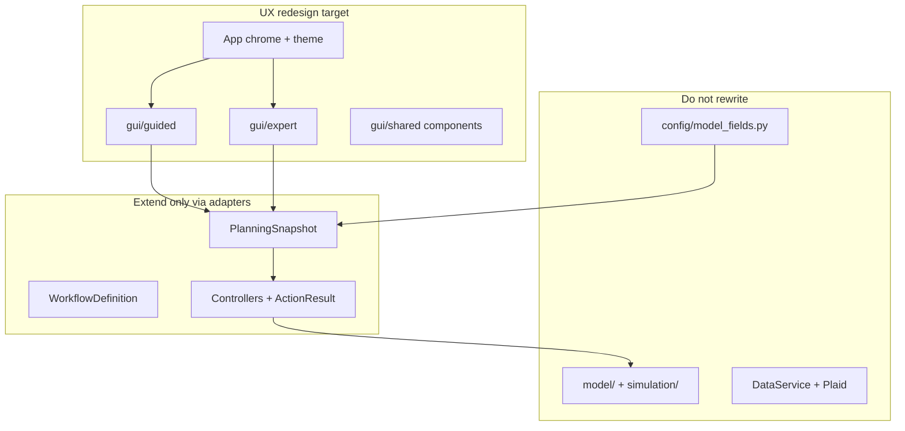

# Comprehensive UX Redesign Plan (Python Beta)

**Version:** 1.0  
**Last updated:** 2026-06-22  
**Status:** Planning complete — UX-1 not started  
**Purpose:** Session handoff for the post-A–G visual/UX polish pass. Read this after `GUI_REDESIGN.md` (phases A–G are done).

**Quick start for new sessions:**
```
Read Retirement_Financial_Modeling/docs/UX_REDESIGN_PLAN.md
Current phase: UX-1 (design system + app shell)
Do not commit until user says so.
```

---

## Vision

Build a **retirement planning studio** — not a tax-season form dump. TurboTax optimizes for compliance anxiety; this product optimizes for **clarity, confidence, and control**.

| Principle | Better than TurboTax |
|-----------|----------------------|
| **Story, not forms** | Journeys named for life decisions ("When do you stop working?") not internal field keys |
| **Progress = confidence** | Plan completeness, not just step count |
| **One focus per screen** | Dense steps (tax, healthcare) split into micro-screens |
| **Power without clutter** | Expert mode feels like an editor, not a spreadsheet |
| **Import later, manual now** | Document upload path designed in from day one, implemented incrementally |

**Your role:** feedback on feel, copy, and priorities after each phase.  
**My role:** lead UI design, information architecture, and implementation structure.

**Visual direction (your choice):** **Dark mode first** — charcoal surfaces, light text, restrained accent (teal or soft blue), high contrast for numbers and charts.

---

## Current Baseline (as of 2026-06-22)

### Completed — GUI Redesign Phases A–G (commit `0d0fecf`)

| Phase | Deliverable | Key files |
|-------|-------------|-----------|
| **A** | Platform-agnostic core | [`app/core/planning_snapshot.py`](../app/core/planning_snapshot.py), [`workflow_definition.py`](../app/core/workflow_definition.py), controllers |
| **B** | Expert sidebar shell | [`gui/expert/app.py`](../gui/expert/app.py), [`sections.py`](../gui/expert/sections.py) |
| **C** | Guided wizard fork | [`gui/guided/app.py`](../gui/guided/app.py) — isolated; does not import expert |
| **D** | LLM batch research | [`app/core/controllers/llm_research_controller.py`](../app/core/controllers/llm_research_controller.py), [`gui/shared/llm_research_panel.py`](../gui/shared/llm_research_panel.py) |
| **E** | Live Data cards | [`gui/shared/live_data_panel.py`](../gui/shared/live_data_panel.py) |
| **F** | Catalog completeness | [`app/core/guided_catalog.py`](../app/core/guided_catalog.py), [`ui_groups.py`](../app/core/ui_groups.py), `tax_wife` step |
| **G** | Performance pass | [`gui/shared/simulation_progress.py`](../gui/shared/simulation_progress.py), [`simulation/cancel.py`](../simulation/cancel.py), `DEFAULT_NUM_PATHS` → 1000 |

**Regression:** 99/99 broad pass; guided/expert fork isolation holds.

### What exists but is still "functional, not polished"

- Bare Tkinter window — no design system, default ttk light theme
- Guided mode: scrollable step with all fields on one page per step (healthcare/tax still dense)
- Expert mode: sidebar works but looks utilitarian
- Results window, Plaid/LLM review dialogs: legacy styling from [`gui/legacy.py`](../gui/legacy.py)
- No journey rail, no completeness ring, no field search
- No document import pipeline
- No py2app bundle — launch via `python main.py`

### Explicitly deferred (per your direction)

- Full V&V / tax return validation pass (engine exists; user verification later)
- Native SwiftUI / App Store
- Selling / notarization

---

## What stays unchanged (robust core)



**Expansion rule:** New fields added once in [`model_fields.py`](../config/model_fields.py) + [`ui_groups.py`](../app/core/ui_groups.py) + [`guided_catalog.py`](../app/core/guided_catalog.py) — both modes update without layout rewrites.

**Package dependency rules (unchanged):**

```
app/core          → config/, model/, simulation/, services/, providers/
gui/shared        → app/core, tkinter
gui/expert        → app/core, gui/shared, tkinter
gui/guided        → app/core, gui/shared, tkinter
gui/guided        -X→ gui/expert   (FORBIDDEN)
gui/expert        -X→ gui/guided   (FORBIDDEN)
main.py           → gui/app.py (mode router)
```

---

## Information architecture

### Top-level shell (new)

Replace bare Tk window with a **persistent app chrome** in [`gui/app.py`](../gui/app.py):

```
┌─────────────────────────────────────────────────────────────┐
│  Retirement Planner          [Guided | Expert]    [?] [⚙]   │
├──────────┬──────────────────────────────────────────────────┤
│ Journey  │  Main content (wizard step OR expert section)    │
│ sidebar  │                                                   │
│ (Guided  │                                                   │
│  only)   │                                                   │
│          │                                                   │
├──────────┴──────────────────────────────────────────────────┤
│  Plan: 68% complete · Last saved: auto        [Run Plan ▶]  │
└─────────────────────────────────────────────────────────────┘
```

- **Guided:** left **journey rail** (collapsible topics, checkmarks, optional steps muted)
- **Expert:** left rail becomes **section nav** (same `UI_GROUPS` IDs — one source of truth)
- **Footer status bar:** completeness %, quick run, data source summary
- **Mode toggle** never destroys data ([`PlanningSnapshot`](../app/core/planning_snapshot.py) shared via [`RetirementApp._switch_mode`](../gui/app.py))

### Guided journeys (restructure presentation, same step IDs)

Keep [`WorkflowDefinition`](../app/core/workflow_definition.py) step IDs stable; change **how** steps render:

| Journey block | Steps | UX treatment |
|---------------|-------|----------------|
| **Start** | setup, timeline | Welcome + life timeline visual |
| **Money in** | income_*, assets_* | One primary question per screen where possible |
| **Money out** | spending_* | Scenario hints ("Go-Go years") |
| **Health** | healthcare_* | Split 21 fields into 3–4 micro-screens |
| **Taxes & income** | tax_benefits, tax_wife | SS/pension first; advanced tax collapsed |
| **Economy** | market | Defaults with "refresh from market" badge |
| **Connect** | live_data, llm_assist | Optional cards, skippable |
| **Your plan** | review | Summary cards + run |

**Micro-screen pattern** for dense steps (e.g. healthcare, tax):

- One question OR one logical group (2–3 related fields) per view
- `Continue` always visible; internal pagination within step via `sub_step_index` in wizard state (new field on `WizardProgress`, not new workflow IDs)

**New `WizardProgress` fields (UX-2):**

```python
@dataclass
class WizardProgress:
    last_step_id: str = "setup"
    completed_steps: list[str] = field(default_factory=list)
    skipped_steps: list[str] = field(default_factory=list)
    sub_step_index: int = 0          # NEW — intra-step pagination
    sub_step_counts: dict[str, int] = field(default_factory=dict)  # NEW — per-step micro-screen count
```

### Expert mode

- Same sections as journey rail (reuse `UI_GROUPS` from [`ui_groups.py`](../app/core/ui_groups.py))
- **Field search** (filter by label/key) — new [`gui/shared/field_search.py`](../gui/shared/field_search.py)
- Grouped collapsible panels (unchanged data model, better chrome)
- "Jump to Guided" link on section headers for users who prefer questions

---

## Design system (Phase UX-1)

New package: [`gui/design_system/`](../gui/design_system/)

| Module | Purpose |
|--------|---------|
| `tokens.py` | Colors, spacing, radii, fonts (dark palette) |
| `typography.py` | Title, question, body, caption, mono for numbers |
| `components/` | `PrimaryButton`, `Card`, `ProgressRing`, `JourneyRail`, `QuestionBlock`, `StatusBar` |
| `apply.py` | `install_theme(root)` — ttk styles + Tk widget defaults |

**Dark palette (starting point):**

| Token | Value | Use |
|-------|-------|-----|
| `bg` | `#1c1c1e` | Window background |
| `surface` | `#2c2c2e` | Cards, panels |
| `elevated` | `#3a3a3c` | Inputs, hover states |
| `text_primary` | `#f5f5f7` | Headlines, values |
| `text_secondary` | `#98989d` | Help text, labels |
| `accent` | `#64d2ff` | Primary actions (teal-blue) |
| `success` | `#30d158` | Completeness, live data |
| `warning` | `#ffd60a` | Missing fields, stale data |
| `error` | `#ff453a` | Validation failures |

**Typography scale:**

- `title` — 22pt semibold (journey block names)
- `question` — 18pt regular (guided prompts)
- `body` — 14pt regular
- `caption` — 12pt secondary color
- `mono` — SF Mono / Menlo for dollar amounts

**Rule:** Views import components only — **no** simulation or Plaid logic in `gui/design_system/`.

---

## Document import capability (future-ready architecture)

You do not know all fields or document types yet — design for **plug-in extraction**, not a fixed upload form.

### Core layer (add in Phase UX-5)

```
app/core/document_ingestion/
  types.py          # DocumentType enum + MIME hints (extensible)
  extraction.py     # ExtractedFieldSuggestion(field_key, value, confidence, source_quote)
  ingestion_controller.py  # ingest(path) -> ActionResult[list[ExtractedFieldSuggestion]]
```

### Provider plug-ins (empty stubs initially)

```
providers/document_extractors/
  base.py           # DocumentExtractor protocol
  tax_return_json.py  # reuse existing tax return validator shape
  stub_llm.py       # future: PDF/image → LLM structured extract (stub only until doc types defined)
```

### UI flow (when ready)

1. Guided step **`import_documents`** (optional, early in journey) — drag/drop zone
2. Controller parses → **review table** (like LLM batch review in [`batch_research_review_dialog.py`](../gui/shared/batch_research_review_dialog.py)) — accept/reject per field
3. Apply to [`PlanningSnapshot`](../app/core/planning_snapshot.py) via existing [`FieldBinder`](../gui/shared/field_binder.py) + source label `"Imported from {doc}"`

### Snapshot extension (version 2 when needed)

- `snapshot_version: 2` adds optional `import_history: []` — does not break v1 saves
- Unknown fields map to `suggested_fields[]` with `field_key: null` until catalog grows

**Phase UX-5 deliverable:** architecture + stub UI ("Coming soon" for unsupported types) + one working extractor (tax return JSON from [`validation/tax_return_template.json`](../validation/tax_return_template.json)) to prove the pipeline.

---

## Key screens (creative direction)

### 1. Welcome / Setup

- Headline: "Let's build your retirement picture"
- Household + state on one calm screen
- Mini timeline graphic appears after ages entered

### 2. Plan completeness (persistent)

- Ring or bar in status bar: % of **high-impact** fields filled (weighted map in `guided_catalog`, not all fields equal)
- Tap opens "What's missing?" checklist

**Completeness weights (starting point):**

| Field group | Weight | Rationale |
|-------------|--------|-----------|
| Ages, retirement age | 15% | Drives entire timeline |
| Initial assets | 15% | Starting point for projection |
| Base expenses | 15% | Runway calculation |
| SS / pension | 10% | Income floor |
| Tax rates | 10% | After-tax accuracy |
| Healthcare | 10% | Major cost driver |
| Market assumptions | 5% | Has sensible defaults |
| Advanced scenarios | 5% | Optional |
| Live data / LLM | 0% | Optional enrichments |

### 3. Question screens

```
┌─────────────────────────────────────────┐
│  Money in · Step 2 of 5                 │
│  ━━━━━━━━░░░░░░░░░░  40%              │
│                                         │
│  When do you plan to retire?            │
│                                         │
│  ┌─────────────────────────────────┐   │
│  │  62                             │   │
│  └─────────────────────────────────┘   │
│                                         │
│  ℹ  Used to project savings and        │
│     Social Security timing.             │
│                                         │
│         [← Back]      [Continue →]      │
└─────────────────────────────────────────┘
```

### 4. Review ("Your plan")

- Cards: Timeline, Assets, Spending, Healthcare, Taxes — tap to jump back
- Simulation mode simple chips (Deterministic / Monte Carlo)
- Primary CTA: **Run plan** (not "Run Simulation")

### 5. Results

- Dark charts consistent with shell
- Tab labels plain English: "Household", "You", "Spouse", "Scenarios"
- Matplotlib colors: `#64d2ff` (median), `#3a3a3c` (fan band), `#f5f5f7` (axis labels)

---

## Implementation phases (with feedback gates)

Each phase ends with **you running the app** and feedback before the next phase starts.

### UX-1 — Design system + app shell (1–2 sessions)

**Tasks:**

| # | Task | File(s) |
|---|------|---------|
| 1.1 | Create `tokens.py`, `typography.py`, `apply.py` | `gui/design_system/` |
| 1.2 | Build `PrimaryButton`, `Card`, `StatusBar` components | `gui/design_system/components/` |
| 1.3 | Wrap `RetirementApp` with persistent header + footer chrome | `gui/app.py` |
| 1.4 | Apply dark theme globally on launch | `main.py` → `install_theme(root)` |
| 1.5 | Restyle Guided header/footer as proof of concept | `gui/guided/app.py` |

**Gate:** app launches; Guided/Expert still function; `python scripts/regression_test.py --only "GUI,Phase 5"` passes

### UX-2 — Journey rail + micro-screens (2–3 sessions)

**Tasks:**

| # | Task | File(s) |
|---|------|---------|
| 2.1 | `JourneyRail` component tied to `WorkflowDefinition` | `gui/design_system/components/journey_rail.py` |
| 2.2 | Add `sub_step_index` to `WizardProgress` + JSON round-trip | `app/core/planning_snapshot.py` |
| 2.3 | Micro-screen pagination in guided step renderer | `gui/guided/app.py`, `gui/shared/field_panel.py` |
| 2.4 | Split healthcare (21 fields) into 3–4 micro-screens | `app/core/guided_catalog.py` (micro-screen groupings) |
| 2.5 | Split tax_benefits + tax_wife similarly | same |
| 2.6 | `ProgressRing` + completeness % in status bar | `gui/design_system/components/progress_ring.py`, `gui/app.py` |

**Gate:** full guided walk-through feels less overwhelming; completeness ring updates live

### UX-3 — Expert editor polish (1–2 sessions)

**Tasks:**

| # | Task | File(s) |
|---|------|---------|
| 3.1 | Section nav matches journey rail styling | `gui/expert/app.py`, `sections.py` |
| 3.2 | Field search bar with live filter | `gui/shared/field_search.py` |
| 3.3 | Collapsible group cards with design system | `gui/shared/catalog_sections.py` |
| 3.4 | "Jump to Guided" on section headers | `gui/expert/sections.py` |

**Gate:** you can find and edit any field faster than today

### UX-4 — Results + dialogs (1–2 sessions)

**Tasks:**

| # | Task | File(s) |
|---|------|---------|
| 4.1 | Restyle `ResultsWindow` with dark theme | `gui/legacy.py` (or extract to `gui/shared/results_window.py`) |
| 4.2 | Dark-friendly matplotlib chart palette | `gui/legacy.py` chart setup |
| 4.3 | Restyle simulation progress dialog | `gui/shared/simulation_progress.py` |
| 4.4 | Restyle Plaid/LLM/expense review dialogs | `gui/legacy.py`, `batch_research_review_dialog.py` |
| 4.5 | Rename tabs: Household / You / Spouse / Scenarios | results window |

**Gate:** run simulation end-to-end looks cohesive in dark mode

### UX-5 — Document import scaffold (1 session)

**Tasks:**

| # | Task | File(s) |
|---|------|---------|
| 5.1 | `document_ingestion` types + controller | `app/core/document_ingestion/` |
| 5.2 | `DocumentExtractor` protocol + tax return JSON extractor | `providers/document_extractors/` |
| 5.3 | Optional guided step `import_documents` (stub for unsupported types) | `ui_groups.py`, `gui/guided/` |
| 5.4 | Review/apply dialog (reuse LLM batch pattern) | `gui/shared/document_import_dialog.py` |
| 5.5 | Add `import_history` to snapshot v2 (backward compatible) | `planning_snapshot.py` |

**Gate:** import tax return JSON → field suggestions → review → apply works end-to-end

### UX-6 — Double-click `.app` (1 session)

**Tasks:**

| # | Task | File(s) |
|---|------|---------|
| 6.1 | `setup.py` py2app configuration | `../setup.py` |
| 6.2 | Bundle resources (icons, `.env.example` guidance) | `assets/` |
| 6.3 | Test launch from `/Applications` without terminal | manual verification |

**Gate:** double-click from Applications, no terminal; personal use, unsigned OK

### UX-7 — Feedback iteration (ongoing)

- Your notes → targeted polish (copy, spacing, journey order, completeness weights)
- No new features until UX stable
- Update [`GUI_REDESIGN.md`](GUI_REDESIGN.md) with UX phase completion

---

## Modification safety (your requirement #3)

| Change type | Touch |
|-------------|-------|
| New field | `model_fields.py`, `ui_groups.py`, `guided_catalog.py` only |
| New guided question | `guided_catalog.py` |
| New journey step | `ui_groups.py` + `WorkflowDefinition` auto-picks it up |
| New document type | New class in `providers/document_extractors/` + register in controller |
| Visual tweak | `gui/design_system/` only |
| Tax/engine fix | `model/` — **no GUI changes** |

Forbidden: business logic in `gui/guided` or `gui/expert` — only in `app/core/controllers/`.

---

## Regression and quality gates

After every UX phase:

```bash
cd Retirement_Financial_Modeling
python scripts/regression_test.py --only "GUI,Phase 5"
```

- Guided/expert fork isolation must hold (no `gui/guided` → `gui/expert` imports)
- `PlanningSnapshot` round-trip unchanged (add tests for v2 fields when introduced)
- No new per-field Research buttons (batch LLM section only)
- Background simulation + cancel still works

---

## Deferred (explicitly later)

| Item | Notes |
|------|-------|
| Native SwiftUI / App Store | After Python UX stable; reuse `PlanningSnapshot` JSON |
| Full PDF/OCR document pipeline | Architecture ready in UX-5; doc types TBD |
| iPad layout | Same `WorkflowDefinition`; refine at native phase |
| Selling / notarization | Personal tool only |
| Full V&V pass | [`VERIFICATION_AND_VALIDATION.md`](VERIFICATION_AND_VALIDATION.md) — when you're ready |

---

## Related docs

| Doc | Purpose |
|-----|---------|
| [`GUI_REDESIGN.md`](GUI_REDESIGN.md) | Phases A–G (complete) |
| [`IMPLEMENTATION_PLAN.md`](IMPLEMENTATION_PLAN.md) | Live data, Monte Carlo, native app roadmap |
| [`VERIFICATION_AND_VALIDATION.md`](VERIFICATION_AND_VALIDATION.md) | Tax accuracy validation (deferred) |

---

## First session when you say "execute"

1. Create `gui/design_system/` with dark tokens
2. Wrap [`gui/app.py`](../gui/app.py) with new shell (header + status bar)
3. Apply theme to Guided header/footer as proof
4. You review live app → feedback round before UX-2

---

*End of UX redesign plan.*
